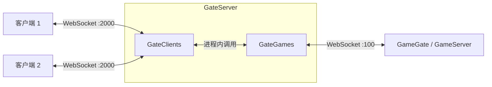
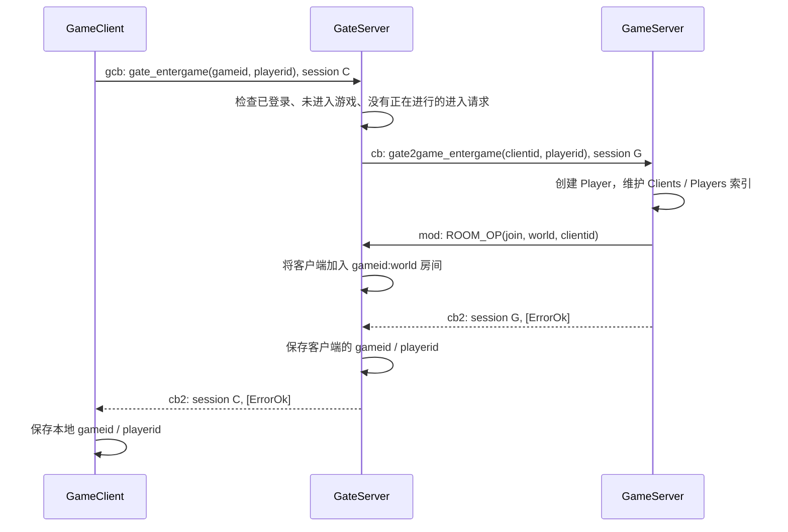

# LiteSocket 示例

编译后的完整库和浏览器客户端库示例位于 [`lib/`](lib/README.md)，运行 `pnpm example:lib`，然后打开终端显示的页面地址。

在 LiteSocket 根目录运行：

```sh
pnpm install
pnpm example
```

`example_lite_msg.ts` 演示普通消息、同步 RPC、异步 RPC 和消息观察日志。服务端使用系统分配的空闲端口，示例结束后关闭客户端和服务端。

示例直接引用 `src/`，使用 `console` 实现日志接口、Node.js 的定时器实现异步等待，无需原业务项目、Winston 或 ts-node。编译产物位于 `.example-build/`。

RPC 返回业务结果时使用 `[ErrorEnum.ErrorOk, 结果]`，客户端通过 `asend` 接收错误码和结果。`asende` 只返回错误码，不能用于接收计算结果。

## Gate：客户端、网关和游戏服之间的消息流转

[`example_gate.ts`](example_gate.ts) 演示一套可以实际收发消息的 Gate/Game 结构：客户端登录网关、选择游戏服和玩家编号，随后进行私聊、房间广播、主动退出，以及由游戏服通知网关断开客户端。

这套示例的重点是**多段连接上的消息如何协作**。网关需要区分哪些消息由自己处理、哪些消息需要转发；转发时补充发送者身份或移除目标连接编号；跨两段连接的 RPC 还要分别管理 session，最终把响应交还给最初的调用者。退出、断线和房间成员也必须随着这些消息一起清理。

`src/game/` 是便于阅读和修改的业务示例，不从 npm 库入口导出。登录目前只是演示状态切换，玩家数据保存在内存中；可以沿着这个结构接入自己的账号、角色和游戏逻辑。

### 运行与阅读入口

在项目根目录运行：

```sh
pnpm example:build
node .example-build/example/example_gate.js
```

也可以在 VS Code 中打开 `example_gate.ts`，选择“调试当前示例文件”后按 F5。

当前例子监听内网游戏服入口 `100` 和外网客户端入口 `2000`，连接地址均为 `127.0.0.1`。端口占用时监听器会等待重试；可以修改示例开头的 `gateport`、`clientport`。小于 1000 的内网端口是本例约定，不代表端口号自身提供访问隔离。

推荐按以下顺序阅读：

| 文件 | 负责的事情 |
| --- | --- |
| [`example_gate.ts`](example_gate.ts) | 把 Gate、Game 和两个客户端组装起来，依次执行演示流程 |
| [`GameClient.ts`](../src/game/GameClient.ts) | 客户端的登录、进入游戏、私聊、广播和退出接口 |
| [`GateServer.ts`](../src/game/GateServer.ts) | 组装内外两个入口，处理登录、进入游戏、退出、房间命令 |
| [`GateClients.ts`](../src/game/GateClients.ts) | 接收客户端消息，决定本地处理还是转发到游戏服 |
| [`GateGames.ts`](../src/game/GateGames.ts) | 接收游戏服消息，按客户端连接编号转发回来 |
| [`GameGate.ts`](../src/game/GameGate.ts) | 游戏服连接 Gate 的客户端，以及发送到指定客户端的封装 |
| [`GameServer.ts`](../src/game/GameServer.ts) | 玩家索引、进入退出、私聊和房间广播业务 |
| [`MsgGame.ts`](../src/game/MsgGame.ts) | Gate/Game 与客户端的消息枚举 |

### 1. 三个角色、两段连接



Gate 内部有两个 `IOServer`：

- `GateClients` 面向客户端，保存每条连接的登录状态、所属游戏服和玩家编号。
- `GateGames` 面向游戏服，保存每条游戏服连接对应的业务 `gameid`。

两者通过 `route` 互相引用，在同一个 Gate 进程内直接调用。`GameGate` 虽然运行在游戏服中，但继承的是 `IOClient`，由它主动连接 Gate 的内网入口。

因此，完整链路涉及两段独立的网络连接：`Client ↔ Gate` 和 `Gate ↔ Game`。客户端无需直接连接游戏服；同一个 Gate 可以接受多个游戏服注册，再按玩家选择的 `gameid` 路由。

### 2. 先分清四种编号

| 编号 | 含义与用途 |
| --- | --- |
| `gameid` | 游戏服的业务编号，例如 `100`；通过 `GateGames.findGame(gameid)` 查找对应的游戏服连接 |
| `clientid` | 客户端连接在 Gate 外网入口中的 socket ID；用于网络投递与定位连接 |
| `playerid` | 玩家或角色的业务编号，本例使用 `123`、`456`；私聊接口以它作为目标 |
| `session` | 一次 RPC 在某一段连接上的请求编号；用于匹配响应，与玩家身份无关 |

游戏服连接在 `GateGames` 中还有自己的 socket ID。它与业务 `gameid` 也可能不同，不能直接用 `findById(gameid)` 代替 `findGame(gameid)`。

游戏服维护两份索引，指向同一个 `Player`：

```text
Clients[clientid] ──→ Player { clientid, playerid } ←── Players[playerid]
```

收到请求后，通过 `clientid` 找发送者；发送私聊时，通过目标 `playerid` 找接收者，再取出接收者的 `clientid` 交给 Gate 投递。这样业务使用稳定的玩家编号，转发层使用当前连接编号。

### 3. event 负责通道，msgid 负责业务

线上 JSON 的外层是 `{ e: event, d: data }`。`event` 决定处理通道，数组中的枚举 `msgid` 再决定业务处理函数。下面以枚举项名称代替具体数字展示消息内容。

| 方向 | event | 接收端的处理方式 |
| --- | --- | --- |
| Client → Gate | `g` | Gate 自己处理的普通消息 |
| Client → Gate | `gcb` | Gate 自己处理的 RPC，例如登录、进入游戏、退出 |
| Client → Gate → Game | `mod` | Gate 补入发送者 `clientid`，再以 `mod` 转发到 Game |
| Client → Gate → Game | `cb` | Gate 补入 `clientid`，建立下一段 RPC，再以 `cb` 转发到 Game |
| Game → Gate | `mod` / `cb` | Gate 自己处理的游戏服命令，例如注册、房间操作和广播命令 |
| Game → Gate → Client | `gmod` | Gate 取出目标 `clientid`，再以 `mod` 投递到 Client |
| Game → Gate → Client | `gcb` | Gate 取出目标 `clientid`，建立下一段 RPC，再以 `cb` 投递到 Client |
| RPC 接收端 → 请求端 | `cb2` | 在当前连接上按 session 返回结果 |
| Gate → 房间成员 | `bc` | 客户端通过 `onBroadcast()` 接收广播 |

这里的 `gcb` 要结合连接方向理解：客户端发给 Gate，表示“请求 Gate 处理”；游戏服发给 Gate，表示“请 Gate 转交给某个客户端”。它们分别由 `GateClients` 和 `GateGames` 接收。

当前实现中，**客户端向游戏服转发仍使用 `mod/cb`**；`gmod/gcb` 用于游戏服指定目标客户端的反向投递。

`GateClients` 专门覆盖了默认消息绑定：把 `mod/cb` 交给路由，把 `g/gcb` 交给 Gate 的业务处理器。同时仍调用 `socket.createSession()`，因为 Gate 还需要主动向客户端发起 RPC、接收 `cb2`。

### 4. 启动、登录和进入游戏

启动和注册按以下顺序完成：

1. `GateServer.start()` 先监听游戏服入口，再监听客户端入口。
2. `GameServer.start()` 通过 `GameGate` 连接内网入口。
3. Game 发起 `game2gate_info(gameid)` RPC，Gate 在该连接的 `customData` 中记录 `gameid`。
4. Game 等到注册确认后才返回启动成功，此时 Gate 已经能够查找到它。
5. 两个客户端连接外网入口，分别调用 `login()` 和 `enterGame(gameid, playerid)`。

`login()` 发送 `gcb [gate_login, session]`，由 Gate 直接修改登录状态并返回 `[ErrorOk]`。

`enterGame()` 需要跨两段连接完成：



Gate 在等待 Game 回复时设置 `entering` 标记，避免同一客户端并发进入两个游戏服。进入期间客户端已经断线，则在 Game 回复成功后补发断线通知，清理刚创建的玩家。

### 5. 私聊：业务请求与消息投递是两条链路

例子中的调用为：

```ts
await c1.chatDes(c2.playerid, 'hello');
```

它包含一个“发送私聊”的 RPC，以及游戏服主动投递给接收者的普通消息。

请求先到达 Gate：

```text
Client 1 → GateClients
cb [game_chat, 456, "hello", session C]
```

Gate 根据 Client 1 连接中保存的 `gameid` 找到游戏服，把发送者的 `clientid` 插到 `msgid` 后面，移除旧 session，并在下一段连接上建立新 RPC：

```text
GateGames → GameGate
cb [game_chat, clientid1, 456, "hello", session G]
```

`GameServer` 的处理函数接收业务参数 `(clientid1, desid, chat)`。它通过 `Clients[clientid1]` 找到发送者，通过 `Players[456]` 找到接收者，再调用：

```ts
this.gate.sendClient(p2.clientid, [MsgClientEnum.c_chat, p1.playerid, chat]);
```

反向投递时，目标连接编号放在数组最前面，Gate 取走它以后再交给客户端：

```text
GameGate → GateGames
gmod [clientid2, c_chat, 123, "hello", 0]

GateClients → Client 2
mod [c_chat, 123, "hello", 0]

Client 2 的 onMessage(c_chat, ...) 收到业务参数：123, "hello"
```

尾部的 `0` 来自普通发送的封包规则，表示不等待 RPC 回调。业务处理函数只声明自己需要的参数即可。

同时，游戏服返回 `[ErrorOk]`，响应沿原请求链路回到 Client 1。`chatDes()` 返回成功表示游戏服已处理发送请求；本例没有再等待 Client 2 确认收到或已读。

### 6. RPC 跨 Gate：每一段连接各有自己的 session

Client 和 Game 不共享一个 RPC session 空间。不同客户端、不同连接甚至可能同时使用相同的 session 数字，因此 Gate 必须分别处理两段连接的请求与响应。

以客户端请求游戏服为例：

```text
Client → Gate     cb  [msgid, ...args, C]
Gate → Game      cb  [msgid, clientid, ...args, G]
Game → Gate      cb2 [G, result]
Gate → Client    cb2 [C, result]
```

`GateClients.routeMsg()` 保存客户端 session `C`，执行 `data.pop()` 将它移出，再 `await game.asendMod(...)`。下一段 Session 自动附加 `G`；收到 Game 的结果后，Gate 使用保存的 `C` 回复最初的客户端。`C`、`G` 是两段请求的标记，实际数值可以恰好相同。

**旧 session 必须先取出。** 如果直接把整包交给下一段 RPC，下一段会再追加一个 session，上一段的编号就会混入业务参数。

游戏服主动请求客户端时使用相同机制：

```ts
const result = await game.gate.asendClient(clientid, [msgid, ...args]);
```

```text
Game → Gate      gcb [clientid, msgid, ...args, G]
Gate → Client    cb  [msgid, ...args, C]
Client → Gate    cb2 [C, result]
Gate → Game      cb2 [G, result]
```

客户端通过 `onCallback(msgid, handler)` 注册接收函数，返回 `[ErrorOk, ...结果]`。这是通信层支持的另一条路径，当前主例子没有额外加入它；测试中的双向 RPC 用例覆盖了这条链路。

等待响应的一端需要开启 `checktimeout` 才会自动检查 RPC 超时。Gate 的内外两个 `IOServer` 都显式开启了检查，示例的 `GameClient` 和 `GameGate` 也开启了检查。超时或断线的结果仍沿各自的 session 返回；这不代表业务操作会自动撤销，也不会自动重发已经发出的业务请求。

### 7. 房间广播：Game 决定业务，Gate 维护连接成员

客户端 WebSocket 连接实际位于 Gate，因此房间成员保存在 `GateClients.io`。Game 通过普通命令告诉 Gate 加入、离开或解散哪个房间：

```text
Game → GateGames
mod [MSG_C2S_ROOM_OP, "join", "world", clientid, 0]

GateServer.roomMessage()
  → 房间名变为 "100:world"
  → GateClients.io.opRoomId("join", "100:world", clientid)
```

`GameServer.enterGame()` 创建玩家时会加入 `world`，退出时会发送 `leave`。房间名加上 `gameid:` 前缀，让不同游戏服的同名房间相互隔离；分隔符也避免编号与房间名直接拼接发生碰撞。

客户端调用 `bcChat('world!')` 后，先以 `cb` 经过 Gate 转到 Game。Game 找出发送者的 `playerid`，再通知 Gate 广播：

```text
Client 2 → Gate → Game
cb: game_bcchat(clientid2, "world!")

Game → GateGames
mod [MSG_C2S_ROOM_BC, "world", [bc_chat, 456, "world!"], 0]

GateServer → GateClients
bc("100:world", [bc_chat, 456, "world!"])

Gate → 房间中的 Client 1、Client 2
bc [bc_chat, 456, "world!"]
```

客户端使用 `onBroadcast(bc_chat, ...)` 接收。广播包含发送者自己，只发给当前房间成员，未进入该游戏房间的连接不会收到。外层的房间命令 session/普通发送标记不会被加进内层广播业务数组。

### 8. 主动退出、客户端断线和游戏服踢人

三种路径最终都要清理玩家索引、房间成员和 Gate 状态，但发起方与应答顺序不同。

| 场景 | 消息流转与清理 |
| --- | --- |
| 客户端主动 `await exit()` | Client 以 `gcb` 请求 `gate_exit`；Gate 再 RPC 请求 Game 的 `gate2game_exit`；Game 删除两份玩家索引并发送离开房间命令；Gate 清理登录与路由状态后回复；Client 收到确认后清理本地状态，再断开连接 |
| 客户端网络断线 | `GateClients.onClientDisconnected()` 向所属 Game 普通发送 `gate2game_disconnect(clientid)`；Game 删除玩家、离开房间，并用 `game2gate_exit(clientid, 'disconnect')` 通知 Gate；传输层关闭连接时也会清理房间成员 |
| 游戏服主动 `exitGame(playerid, why)` | Game 通过玩家索引找到 `clientid`，发送 `game2gate_exit(clientid, why)`，同时删除玩家并离开房间；Gate 清理客户端状态并断开该连接 |

主动退出时，**Gate 要先返回 RPC 结果，再由 Client 断开**。如果 Gate 在返回 `cb2` 前就关闭连接，客户端可能得到断线错误，而不是正常的退出确认。

Game 收到断线通知后回传的 `why === 'disconnect'` 用于说明这是对已发生断线的清理通知，Gate 不再重复主动断开。游戏服主动退出的路径则先清除 Gate 中的玩家状态，后续连接关闭不会再按“仍在游戏中”重复通知游戏服。

这里的 `gate2game_disconnect` 指的是“Gate 通知 Game 某个客户端断线”。Game 与 Gate 之间的连接中断是另一种情况：本例已开启底层自动重连，但重连后的重新注册、玩家会话恢复和房间重建还需要进一步实现。

### 9. 演示结果与测试

当前 `example_gate.ts` 依次执行：

1. 启动 Gate，注册 Game `100`，连接两个客户端。
2. 登录并进入玩家 `123`、`456`，自动加入 `100:world`。
3. 玩家 `123` 向玩家 `456` 私聊 `hello`。
4. 玩家 `456` 广播 `world!`，两个房间成员都能收到。
5. 玩家 `456` 主动退出；再次向 `456` 私聊会返回 `des not in game`。
6. Game 主动让玩家 `123` 退出，Gate 断开对应客户端，示例结束。

复杂的边界验证放在 `test/game/`，保持主例子便于顺着流程阅读：

```sh
pnpm test:game
```

测试覆盖登录与进入条件、按 `playerid` 私聊、双向 RPC 的 session 隔离、退出与断线清理、进入期间断线、并发进入，以及跨游戏服房间隔离和广播成员变化。完整测试安排见 [`test/README.md`](../test/README.md)。
